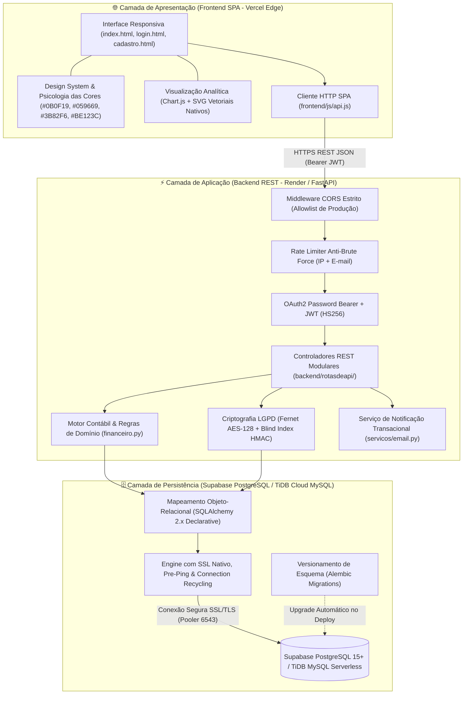

# 🏛️ Arquitetura e Estrutura do Projeto

> 🌐 **Aplicação Web (Vercel):** [https://fluxo-caixa-coral-two.vercel.app](https://fluxo-caixa-coral-two.vercel.app)  
> ⚡ **API REST (Render):** [https://fluxo-caixa-cuq1.onrender.com](https://fluxo-caixa-cuq1.onrender.com)  
> 📖 **Swagger OpenAPI:** [https://fluxo-caixa-cuq1.onrender.com/docs](https://fluxo-caixa-cuq1.onrender.com/docs)  
> 🗄️ **Banco de Dados:** [Supabase PostgreSQL](https://supabase.com) (Pooler AWS porta 6543) / Compatível com MySQL 8

Este documento detalha o mapa arquitetural completo do **Sistema de Fluxo de Caixa**, explicando a topologia de nuvem, a separação de responsabilidades em camadas (SoC), os padrões de projeto, a modelagem de dados e o fluxo de dados ponta a ponta.

---

## 📐 Topologia de Nuvem e Separação de Responsabilidades (SoC)

O projeto adota uma arquitetura desacoplada em três camadas independentes em produção, com total paridade para execução local:



---

## 🧩 Camadas da Aplicação e Padrões de Projeto

### 1. Camada de Apresentação (Frontend SPA & Landing Page)
- **Tecnologia:** HTML5 Semântico, CSS3 Design System (Custom Properties, Flexbox e CSS Grid), Vanilla JavaScript (ES6+) e Chart.js.
- **Design System Dual-Theme (WCAG AA) & Hierarquia de Botões:**
  - *Modo Claro:* Fundo `#F8FAFC`, superfícies `#FFFFFF`, texto `#0F172A` e botões primários `#10B981` com **texto preto (`#0B0F19`, peso 700)**.
  - *Modo Escuro:* Fundo `#0B0F19`, superfícies `#111827`, inputs `#0F172A`, texto `#F8FAFC` e botões primários `#10B981` com **texto branco (`#FFFFFF`, peso 600)**.
  - *Ações Destrutivas / Logout:* Botão `#logout` / `.btn-logout` **sempre vermelho** (`#DC2626`, hover `#991B1B`) em ambos os temas.
  - *Padronização & Grades Anti-Estouro (`min-width: 0` e `align-items: start`):* `height: 44px` nas barras de filtro, `height: 46px` fixo nos formulários de 3 colunas de Configurações (`repeat(3, minmax(0, 1fr)); align-items: start; gap: 20px;`) e `border-radius: 10px` unificados em inputs, botões, `<input type="date">` e `<select>` customizados, com barras de filtros CSS Grid sem sobreposição (`minmax(190px, 1.3fr) minmax(145px, 1fr) minmax(145px, 1fr) minmax(200px, 1.3fr) auto; gap: 16px; align-items: end;` e breakpoints em `1150px` / `640px`), além de sobrescrita `input:-webkit-autofill` no login.
- **Zero Emojis na Interface:** Identidade visual 100% composta por vetores SVG nativos (`#10B981` -> `#047857`).
- **Validações Reativas & Sidebar Unificada:** Validação Módulo 11 de CPF, formato de e-mail e checklist interativo de 5 regras de senha em tempo real (`<small class="field-error">`), além de cartão `#user-profile-badge` unificado com `#configuracoes` no rodapé da Sidebar.

### 2. Camada de Segurança e Autenticação
- **Autenticação:** Tokens JWT assinados com algoritmo HS256 e tempo de vida configurável via variável de ambiente.
- **Proteção Anti-Força Bruta:** Limitação estrita de 5 tentativas consecutivas de login por janela de 15 minutos, persistidas na tabela `tentativas_login` e bloqueadas com status `HTTP 429 Too Many Requests`.
- **Criptografia e LGPD em Repouso:**
  - CPF e telefone cifrados via **Fernet (AES-128 em modo CBC com assinatura HMAC-SHA256)**.
  - O CPF possui um índice cego determinístico derivado (**Blind Index** via `HMAC-SHA256`) armazenado na coluna `cpf_indice`, permitindo validação de unicidade instantânea sem expor o número real do documento.
- **Hashing de Senhas:** Utilização de `pwdlib` com o algoritmo recomendado **Argon2id** (memória e tempo parametrizados), com fallback automático para Bcrypt.

### 3. Camada de Domínio e Motor Contábil (`backend/financeiro.py`)
- **Aritmética Exata:** Uso exclusivo da classe `Decimal` de Python com 2 casas decimais (`Decimal(12, 2)` no banco), eliminando erros de arredondamento de ponto flutuante IEEE 754.
- **Transferências Atômicas Vinculadas:** Ao transferir valores entre contas, o sistema cria dois registros interligados por um identificador único `transferencia_id` (UUIDv4) e executa a operação em transação atômica protegida por `SELECT ... FOR UPDATE`. Se qualquer ponta for excluída, a contraparte e os respectivos saldos são restaurados atomicamente.
- **Módulo de Investimentos Unificado:** Registro direto de aportes com débito automático da conta bancária de origem e integração com a carteira de patrimônio (Renda Fixa: Poupança, CDB, LCI/LCA, Tesouro Direto, Fundos; Renda Variável: Ações, ETFs, FIIs, Subscrições).
- **Subdivisão Estruturada:**
  - *Entradas:* Ganhos Fixos (Salário) e Ganhos Variáveis (Pix, Vendas, Freela, etc.).
  - *Saídas:* Gastos Fixos e Gastos Variáveis.

### 4. Camada de Persistência e Banco de Dados Relacional
- **Multi-Driver Suportado:** Engine SQLAlchemy 2.x com detecção automática e normalização de `DATABASE_URL`:
  - PostgreSQL / Supabase: `postgresql+psycopg2://...` com pooler PgBouncer e `sslmode=require`.
  - MySQL / TiDB Cloud: `mysql+pymysql://...` com TLS 1.3 nativo (`ssl.create_default_context()`).
  - SQLite: `sqlite:///:memory:` para execução instantânea dos 110 testes automatizados.
- **Versionamento com Alembic:** 16 revisões históricas incrementais gerenciadas em `banco de dados/migrations/versions/`.

---

## 📁 Árvore Completa de Diretórios do Projeto

```text
fluxo_caixas/
├── backend/                            # Núcleo da API REST e regras de negócio
│   ├── rotasdeapi/                     # Controladores REST modulares
│   │   ├── usuario.py                  # Cadastro, login OAuth2, OTP por e-mail, perfil e exclusão
│   │   ├── conta_bancaria.py           # Gestão de contas (corrente, poupança, investimento)
│   │   ├── fluxo_dinheiro.py           # Movimentações, transferências e aportes de investimentos
│   │   ├── calculo_financeiro.py       # Consolidação periódica de relatórios (diário, mensal, anual)
│   │   ├── meta_financeira.py          # Metas de economia com evolução percentual
│   │   ├── orcamentos_alertas.py       # Tetos por categoria, acompanhamento e alertas de vencimento
│   │   └── readme.md                   # Catálogo técnico detalhado de rotas e contratos
│   ├── seguranca/                      # Segurança e criptografia de credenciais
│   │   ├── seguranca.py                # Hashing e verificação de senhas (Argon2id / Bcrypt)
│   │   └── readme.md                   # Manual de segurança e proteção de senhas
│   ├── servicos/                       # Serviços auxiliares e utilitários
│   │   ├── email.py                    # Envio defensivo de e-mails via SMTP com STARTTLS
│   │   ├── google_oauth.py             # Verificação criptográfica de ID Token Google OAuth 2.0
│   │   └── __init__.py                 # Exportador de serviços
│   ├── tests/                          # Suíte de testes automatizados (110 testes passing)
│   │   ├── conftest.py                 # Fixtures globais, banco em memória e TestClient FastAPI
│   │   ├── test_cadastro_usuario.py    # Validação de CPF, complexidade de senha e integridade
│   │   ├── test_seguranca_oauth_lgpd.py# Testes de CPF estrito, senha forte, LGPD, OTP anti-bot e Google OAuth
│   │   ├── test_cors.py                # Preflight CORS, allowlist e ambientes dev/prod
│   │   ├── test_dados_sensiveis.py     # Cifragem Fernet, Blind Index HMAC e privacidade LGPD
│   │   ├── test_financeiro.py          # Precisão Decimal, saldo disponível e transferências
│   │   ├── test_fluxo_integracao.py    # Fluxo end-to-end completo da aplicação
│   │   ├── test_limites_requisicoes.py # Testes de rate limit (HTTP 429) e janelas temporais
│   │   ├── test_metas_relatorios.py    # Testes de metas financeiras e relatórios consolidados
│   │   ├── test_orcamentos_alertas.py  # Testes de tetos orçamentários e regras de alertas
│   │   ├── test_mysql_concorrencia.py  # Testes de concorrência com bloqueio pessimista
│   │   └── README.md                   # Guia de execução da suíte de testes
│   ├── api.py                          # Ponto de montagem FastAPI, CORS, middlewares e healthcheck
│   ├── autenticacao.py                 # Emissão, decodificação e validação de tokens JWT
│   ├── configuracao.py                 # Carregamento tipado e seguro de variáveis de ambiente
│   ├── dados_sensiveis.py              # Implementação Fernet AES-128 e Blind Index HMAC
│   ├── database.py                     # Normalização de URL, SSLContext e engine SQLAlchemy 2.x
│   ├── esquema.py                      # Modelos de validação de dados Pydantic v2
│   ├── financeiro.py                   # Motor de cálculos contábeis e recálculo de saldos
│   ├── models.py                       # Entidades relacionais ORM (10 tabelas mapeadas)
│   └── readme.md                       # Documentação interna da camada backend
│
├── banco de dados/                     # Esquema relacional e migrações Alembic
│   ├── migrations/                     # Histórico versionado de migrações
│   │   ├── versions/                   # 16 arquivos de migração cronológica
│   │   ├── env.py                      # Contexto online/offline de migrações
│   │   └── README.md                   # Guia de comandos e operações Alembic
│   ├── alembic.ini                     # Configuração global do Alembic
│   ├── *.sql                           # Dumps e scripts DDL de referência
│   └── readme.md                       # Diagrama de relacionamentos e dicionário de dados
│
├── frontend/                           # Aplicação Web SPA & Landing Page (hospedada na Vercel)
│   ├── assets/
│   │   └── logo.svg                    # Logotipo corporativo oficial em SVG
│   ├── css/
│   │   └── style.css                   # Design system corporativo (Tema Claro e Escuro), Inter e modais
│   ├── js/
│   │   ├── api.js                      # Cliente HTTP com detecção de ambiente e hook de modais
│   │   ├── legal.js                    # Termos de Serviço, LGPD, CPF em tempo real, checklist de senha e OAuth
│   │   ├── cadastro.js                 # Cadastro com aceite LGPD, validação em tempo real e modal OTP anti-bot
│   │   ├── dashboard.js                # Orquestração do painel, gráficos adaptativos ao tema, filtros e CSV
│   │   └── login.js                    # Autenticação OAuth2, Google OAuth 2.0 e recuperação de senha
│   ├── inicio.html                     # Landing Page de alta conversão com CTAs estratégicos
│   ├── index.html                      # Painel financeiro principal autenticado
│   ├── login.html                      # Tela de login institucional
│   ├── cadastro.html                   # Tela de criação de conta
│   ├── termos.html                     # Página dedicada dos Termos de Serviço
│   ├── privacidade.html                # Página dedicada da Política de Privacidade e LGPD
│   └── README.md                       # Documentação do frontend e deploy na Vercel
│
├── scripts/                            # Scripts utilitários de administração e manutenção
│   ├── migrar_para_supabase.py         # Migração ponta a ponta para Supabase PostgreSQL
│   ├── supabase_schema_completo.sql    # DDL estruturado para o SQL Editor do Supabase
│   ├── remover_usuario_teste.py        # Exclusão segura e transacional de usuários de teste
│   └── README.md                       # Guia de uso dos utilitários
│
├── .env.example                        # Template documentado de variáveis de ambiente
├── .gitignore                          # Exclusões de versionamento do Git
├── .vercelignore                       # Filtro de deploy estático da Vercel
├── ESTRUTURA.md                        # Este documento arquitetural
├── main.py                             # Ponto de entrada unificado para execução local
├── pytest.ini                          # Configuração de descoberta do Pytest
├── README.md                           # Documentação principal do repositório no GitHub
├── requirements.txt                    # Dependências Python fixadas
└── vercel.json                         # Roteamento e rewrites estáticos da Vercel
```
