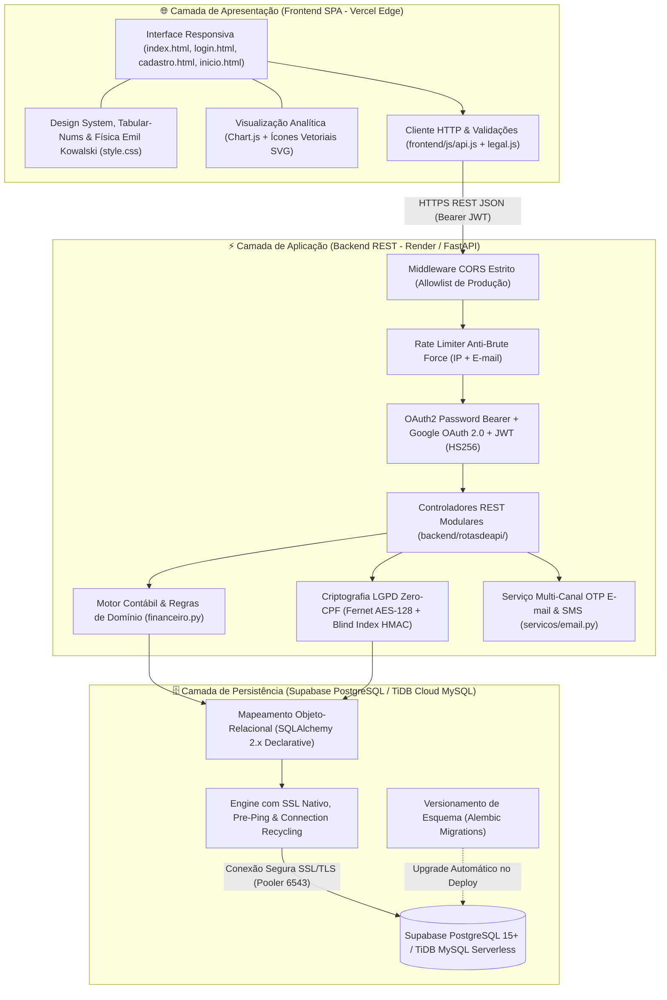

# 🏛️ Arquitetura e Estrutura do Projeto

> 🌐 **Aplicação Web (Vercel):** [https://fluxo-caixa-coral-two.vercel.app](https://fluxo-caixa-coral-two.vercel.app)  
> ⚡ **API REST (Render):** [https://fluxo-caixa-cuq1.onrender.com](https://fluxo-caixa-cuq1.onrender.com)  
> 📖 **Swagger OpenAPI:** [https://fluxo-caixa-cuq1.onrender.com/docs](https://fluxo-caixa-cuq1.onrender.com/docs)  
> 🗄️ **Banco de Dados:** [Supabase PostgreSQL](https://supabase.com) (Pooler AWS porta 6543) / Compatível com MySQL 8

Este documento detalha o mapa arquitetural completo do **Sistema de Fluxo de Caixa**, explicando a topologia de nuvem, os 4 motores de engenharia de design e código, a separação de responsabilidades em camadas (SoC), a arquitetura de privacidade **Zero-CPF** sob a LGPD e o fluxo de dados ponta a ponta.

---

## 📐 Topologia de Nuvem e Separação de Responsabilidades (SoC)

O projeto adota uma arquitetura desacoplada em três camadas independentes em produção, com total paridade para execução local:



---

## 🧩 Camadas da Aplicação e Padrões de Projeto

### 1. Camada de Apresentação & Motores de Design (`Emil Kowalski + Impeccable + Taste-Skill + Ponytail`)
- **Tecnologia:** HTML5 Semântico, CSS3 Design System (Custom Properties, Flexbox e CSS Grid), Vanilla JavaScript (ES6+) e Chart.js.
- **Física e Micro-interações (Emil Kowalski):**
  - Transições compostas pela GPU (`transform`, `opacity`) usando curva `cubic-bezier(0.22, 1, 0.36, 1)` com duração entre `160ms` e `220ms`.
  - Feedback tátil de pressão (`scale(0.97)`) em botões interativos, animação de entrada com mola suave em modais (`@keyframes dialog-spring-in`) e suporte estrito a `prefers-reduced-motion: reduce`.
- **Tipografia, Alinhamento Óptico e Robustez (Impeccable):**
  - Números financeiros, saldos, percentuais e inputs de código OTP utilizam `font-variant-numeric: tabular-nums`.
  - Títulos com `letter-spacing: -0.022em` e textos jurídicos limitados a `66ch` para leitura confortável.
  - Grades de filtros e formulários protegidas contra estouro de layout (`min-width: 0`, `text-overflow: ellipsis`).
- **Curadoria Estética & Conversão (Taste-Skill):**
  - *Modo Claro:* Fundo `#F8FAFC`, superfícies `#FFFFFF`, texto `#0F172A` e botões primários `#10B981` com texto `#0B0F19` (peso 700).
  - *Modo Escuro:* Superfícies em camadas de grafite escuro (`#0B0F19` -> `#111827` -> `#0F172A`) com bordas translúcidas de `1px` (`rgba(255, 255, 255, 0.08)`).
  - *100% Vetorial:* Todos os ícones de navegação e indicadores KPI utilizam vetores SVG nativos, sem emojis ou símbolos Unicode soltos.
  - *Conversão OAuth:* Botão `#google-oauth-btn` destacado no topo do login e do cadastro com feedback visual imediato.
- **Disciplina de Código (Ponytail):**
  - Validações centralizadas em `frontend/js/legal.js` (sem duplicação em `api.js`) e eliminação de estilos inline nas páginas HTML.

### 2. Camada de Segurança, Autenticação Multi-Canal e LGPD Zero-CPF
- **Arquitetura Zero-CPF (Minimização de Dados — Art. 6º, III da LGPD):**
  - O cadastro, o login tradicional, o login com Google e a recuperação de senha operam exclusivamente com **Nome, E-mail, Telefone (DDD) e Senha**.
  - Para manter compatibilidade total com bancos de dados legados sem exigir migração destrutiva de coluna `NOT NULL`, o backend gera automaticamente um identificador criptográfico determinístico a partir do e-mail quando o CPF não é enviado.
- **Verificação 2FA/OTP (E-mail ou SMS):**
  - Disparo de códigos numéricos temporários de 6 dígitos com expiração de 15 minutos, entregues via **E-mail** (API HTTP Resend/Brevo ou SMTP STARTTLS) ou **SMS** (Twilio / Webhook HTTP), com alternância de canal em 1 clique e modo de contingência automático.
- **Criptografia em Repouso e Hashing:**
  - Telefone celular e identificadores sensíveis cifrados com **Fernet (AES-128-CBC + HMAC-SHA256)**.
  - Senhas protegidas com **Argon2id** (`pwdlib`) e tokens de sessão emitidos via **JWT HS256**.
  - Limitação de 5 tentativas de login por janela de 15 minutos (`HTTP 429 Too Many Requests`).

### 3. Camada de Domínio e Motor Contábil (`backend/financeiro.py`)
- **Aritmética Exata:** Uso exclusivo de `Decimal(12, 2)`, eliminando erros de ponto flutuante IEEE 754.
- **Transferências Atômicas Vinculadas:** Operações entre contas geram pares interligados por `transferencia_id` (UUIDv4) protegidos por `SELECT ... FOR UPDATE`.
- **Módulo de Investimentos Unificado:** Registro direto de aportes com débito automático da conta bancária de origem (Renda Fixa e Renda Variável).

### 4. Camada de Persistência e Banco de Dados Relacional
- **Multi-Driver Suportado:** Engine SQLAlchemy 2.x compatível com PostgreSQL/Supabase (Pooler PgBouncer porta 6543), MySQL/TiDB Cloud e SQLite em memória para testes.
- **Versionamento com Alembic:** 16 revisões históricas incrementais em `banco de dados/migrations/versions/`.

---

## 📁 Árvore Completa de Diretórios do Projeto

```text
fluxo_caixas/
├── .agents/                            # Regras globais e Skills de Design Engineering
│   ├── rules/core-skills.md            # Motores: Emil Kowalski + Impeccable + Taste-Skill + Ponytail
│   └── skills/                         # Pacotes de skills especializadas (animate, emil-design-eng, etc.)
├── backend/                            # Núcleo da API REST e regras de negócio
│   ├── rotasdeapi/                     # Controladores REST modulares
│   │   ├── usuario.py                  # Cadastro Zero-CPF, login OAuth2, Google OAuth, OTP E-mail/SMS e perfil
│   │   ├── conta_bancaria.py           # Gestão de contas (corrente, poupança, investimento)
│   │   ├── fluxo_dinheiro.py           # Movimentações, transferências e aportes de investimentos
│   │   ├── calculo_financeiro.py       # Consolidação periódica de relatórios (diário, mensal, anual)
│   │   ├── meta_financeira.py          # Metas de economia com evolução percentual
│   │   ├── orcamentos_alertas.py       # Tetos por categoria, acompanhamento e alertas de vencimento
│   │   └── readme.md                   # Catálogo técnico detalhado de rotas e contratos
│   ├── seguranca/                      # Segurança e criptografia de credenciais
│   │   ├── seguranca.py                # Hashing e verificação de senhas (Argon2id / Bcrypt)
│   │   └── readme.md                   # Manual de segurança e proteção de senhas
│   ├── servicos/                       # Serviços auxiliares e utilitários
│   │   ├── email.py                    # Envio de OTP de 6 dígitos via E-mail (HTTP/SMTP) e SMS
│   │   ├── google_oauth.py             # Verificação criptográfica de ID Token Google OAuth 2.0
│   │   └── __init__.py                 # Exportador de serviços
│   ├── tests/                          # Suíte de testes automatizados (Pytest)
│   ├── api.py                          # Ponto de montagem FastAPI, CORS, middlewares e healthcheck
│   ├── autenticacao.py                 # Emissão, decodificação e validação de tokens JWT
│   ├── configuracao.py                 # Carregamento tipado e seguro de variáveis de ambiente
│   ├── dados_sensiveis.py              # Implementação Fernet AES-128 e Blind Index HMAC
│   ├── database.py                     # Normalização de URL, SSLContext e engine SQLAlchemy 2.x
│   ├── esquema.py                      # Modelos de validação de dados Pydantic v2 (Zero-CPF por padrão)
│   ├── financeiro.py                   # Motor de cálculos contábeis e recálculo de saldos
│   ├── models.py                       # Entidades relacionais ORM (10 tabelas mapeadas)
│   └── readme.md                       # Documentação interna da camada backend
│
├── banco de dados/                     # Esquema relacional e migrações Alembic
│   ├── migrations/                     # Histórico versionado de 16 migrações
│   ├── alembic.ini                     # Configuração global do Alembic
│   └── readme.md                       # Diagrama de relacionamentos e dicionário de dados
│
├── frontend/                           # Aplicação Web SPA & Landing Page (hospedada na Vercel)
│   ├── assets/
│   │   └── logo.svg                    # Logotipo corporativo oficial em SVG
│   ├── css/
│   │   └── style.css                   # Design system corporativo Dual-Theme + física Emil Kowalski (?v=19)
│   ├── js/
│   │   ├── api.js                      # Cliente HTTP enxuto com detecção de ambiente, temas e scroll-lock
│   │   ├── legal.js                    # Termos/LGPD em linguagem clara, validações reativas e Google OAuth
│   │   ├── cadastro.js                 # Cadastro Zero-CPF com escolha de canal 2FA (E-mail/SMS) e modal OTP
│   │   ├── dashboard.js                # Orquestração do painel, gráficos adaptativos ao tema, filtros e CSV
│   │   └── login.js                    # Autenticação OAuth2, Google OAuth 2.0 e recuperação de senha via OTP
│   ├── inicio.html                     # Landing Page de alta conversão com CTAs estratégicos
│   ├── index.html                      # Painel financeiro principal autenticado (100% SVG vetorial)
│   ├── login.html                      # Tela de login institucional com botão Google em destaque
│   ├── cadastro.html                   # Tela de criação de conta Zero-CPF
│   ├── termos.html                     # Página dedicada dos Termos de Uso
│   ├── privacidade.html                # Página dedicada da Política de Privacidade e LGPD
│   ├── vercel.json                     # Configuração de rotas e headers para deploy direto da pasta frontend
│   └── README.md                       # Documentação do frontend e deploy na Vercel
│
├── scripts/                            # Scripts utilitários de administração e manutenção
├── .env.example                        # Template documentado de variáveis de ambiente
├── .gitignore                          # Exclusões de versionamento do Git
├── .vercelignore                       # Filtro de deploy estático da Vercel
├── ESTRUTURA.md                        # Este documento arquitetural
├── main.py                             # Ponto de entrada unificado para execução local
├── pytest.ini                          # Configuração de descoberta do Pytest
├── README.md                           # Documentação principal do repositório no GitHub
├── requirements.txt                    # Dependências Python fixadas
└── vercel.json                         # Roteamento, rewrites e headers estáticos da Vercel
```
