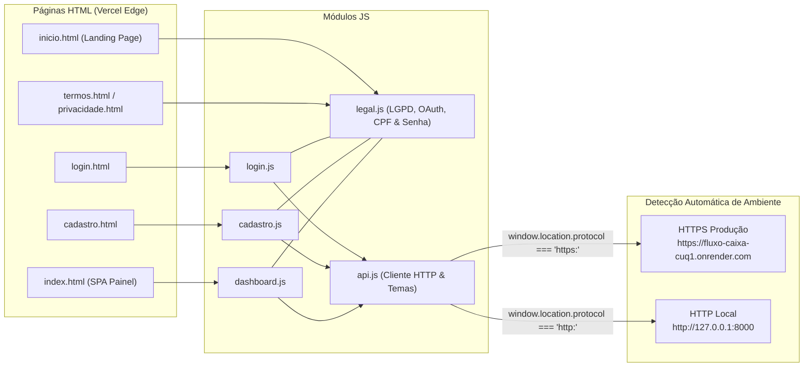

# 🖥️ Frontend — Fluxo de Caixa

> 🌐 **Aplicação Online (Vercel):** [https://fluxo-caixa-coral-two.vercel.app](https://fluxo-caixa-coral-two.vercel.app)

Interface web institucional, rápida, acessível (**WCAG AA**) e responsiva do **Sistema de Fluxo de Caixa**, construída com **HTML5 Semântico, CSS3 Design System (Modo Claro e Modo Escuro), JavaScript Vanilla (ES6+)** e **Chart.js**, publicada na **Vercel Edge Network**.

---

## 🎯 Arquitetura de Comunicação da Interface



---

## 📁 Estrutura de Arquivos

```text
frontend/
├── assets/
│   └── logo.svg             # Logotipo vetorial corporativo oficial (#10B981 -> #047857)
├── css/
│   └── style.css            # Design System WCAG AA (Tema Claro #F8FAFC e Escuro #0B0F19), botões, inputs e modais
├── js/
│   ├── api.js               # Cliente Fetch centralizado, gestão JWT, tradução PT-BR de erros, temas e scroll-lock
│   ├── legal.js             # Termos/LGPD, Google OAuth 2.0, validação Módulo 11 de CPF, e-mail e checklist 5 regras
│   ├── cadastro.js          # Cadastro reativo em tempo real, aceite LGPD e modal OTP anti-bot de 6 dígitos
│   ├── dashboard.js         # Roteador SPA, gráficos Chart.js adaptativos ao tema, filtros, orçamentos e CSV UTF-8
│   └── login.js             # Autenticação OAuth2, Google Identity Services e recuperação de acesso via OTP/CPF
├── inicio.html              # Landing Page institucional com 6 pilares funcionais, segurança LGPD e CTAs
├── index.html               # Painel financeiro principal autenticado (SPA com Sidebar unificada)
├── login.html               # Tela de login institucional com proteção :-webkit-autofill
├── cadastro.html            # Tela de criação de conta com feedback inline <small class="field-error">
├── termos.html              # Página dedicada dos Termos de Serviço
├── privacidade.html         # Página dedicada da Política de Privacidade e Conformidade LGPD
├── vercel.json              # Rewrites, redirecionamento raiz (/ -> /inicio.html) e cabeçalhos de segurança HTTP
└── README.md                # Documentação do frontend e deploy na Vercel
```

---

## ✨ Destaques de UI/UX, Acessibilidade e Segurança

- **Design System Dual-Theme (WCAG AA):**
  - **Modo Claro:** Fundo `#F8FAFC`, cartões/inputs `#FFFFFF`, texto principal `#0F172A` e botões primários verdes (`#10B981`) com **texto preto (`#0B0F19`, peso 700)** para máximo contraste.
  - **Modo Escuro:** Fundo `#0B0F19`, cartões/modais `#111827`, inputs `#0F172A`, texto `#F8FAFC` e botões primários verdes (`#10B981`) com **texto branco (`#FFFFFF`, peso 600)**.
- **Hierarquia Estrita de Botões & Barras de Filtro Anti-Estouro:**
  - Ações principais (`+ Nova movimentação`, `+ Nova conta`, `Exportar CSV`, `Limpar`, `Gerar relatório`, `Salvar`) padronizadas em `.button-primary` (`height: 44px` nos filtros, `border-radius: 10px`).
  - Barras de filtros de **Relatórios** (`#custom-report-form`), **Movimentações** (`#movements-filter-form`) e **Orçamentos** (`#orcamento-form`) estruturadas em CSS Grid (`gap: 16px`, `align-items: end`, `min-width: 0` e `text-overflow: ellipsis` em todos os `.filter-group`, `<select>`, `<input type="date">` e `.custom-select-trigger`), com breakpoints responsivos em `1150px` (2 colunas) e `640px` (1 coluna).
  - Formulários de **Configurações** (`#view-configuracoes` — Dados cadastrais e Alterar senha) alinhados pelo topo (`repeat(3, minmax(0, 1fr)); align-items: start; gap: 20px;`) com altura fixa de `46px` em todos os inputs e `.password-input-wrapper`, impedindo que textos auxiliares ou o card de requisitos de senha desalinhem colunas vizinhas.
  - Encerramento de sessão (`#logout` / `.btn-logout`) **sempre vermelho** (`#DC2626`, hover `#991B1B`) em qualquer tema, com modal defensivo de confirmação.
- **Validações Reativas em Tempo Real:**
  - Cálculo matemático **Módulo 11 de CPF** durante a digitação/desfoque com limpeza imediata do erro ao corrigir.
  - **Checklist interativo de 5 requisitos de senha forte** sincronizado com `backend/esquema.py` + confirmação de senha em tempo real.
  - Validação estrita de formato de e-mail, sobrescrita `input:-webkit-autofill` no login e tradução automática de respostas HTTP `400/409/422` para português.
- **Sidebar Reorganizada:** Cartão de perfil do usuário (`#user-profile-badge`) sempre visível no rodapé lateral e unificado diretamente com a aba `#configuracoes`.
- **Exportação CSV UTF-8 com BOM (`\uFEFF`):** Compatibilidade direta com Microsoft Excel e Google Sheets preservando acentuação em português.

---

## ☁️ Roteamento na Vercel (`vercel.json`)

| Rota Amigável | Destino Estático | Descrição |
|---|---|---|
| `/` | `/inicio.html` | Redireciona visitantes para a Landing Page institucional |
| `/inicio` | `/inicio.html` | Apresentação de recursos, segurança LGPD e CTAs |
| `/login` | `/login.html` | Acesso institucional e Login Social Google OAuth 2.0 |
| `/cadastro` | `/cadastro.html` | Abertura de conta com verificação OTP anti-bot |
| `/dashboard` | `/index.html` | Painel financeiro autenticado (SPA) |
| `/termos` | `/termos.html` | Termos de Serviço |
| `/privacidade` | `/privacidade.html` | Política de Privacidade e LGPD |

---

## 🚀 Como Executar Localmente

Na raiz do projeto:
```powershell
python -m http.server 5173 --bind 127.0.0.1 --directory frontend
```
Acesse `http://127.0.0.1:5173/inicio.html` ou `http://127.0.0.1:5173/login.html`.
