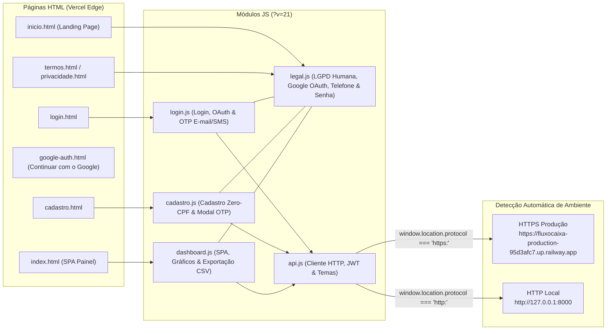

# 🖥️ Frontend — Fluxo de Caixa

> 🌐 **Aplicação Online (Vercel):** [https://fluxo-caixa-coral-two.vercel.app](https://fluxo-caixa-coral-two.vercel.app)

Interface web institucional, rápida, acessível (**WCAG AA**) e responsiva do **Sistema de Fluxo de Caixa**, construída com **HTML5 Semântico, CSS3 Design System Dual-Theme, JavaScript Vanilla (ES6+)** e **Chart.js**, refinada com os 4 motores de engenharia (**Emil Kowalski + Impeccable + Taste-Skill + Ponytail**) e publicada na **Vercel Edge Network**.

---

## 🎯 Arquitetura de Comunicação da Interface



---

## 📁 Estrutura de Arquivos

```text
frontend/
├── assets/
│   └── logo.svg             # Logotipo vetorial corporativo oficial (#10B981 -> #047857)
├── css/
│   └── style.css            # Design System WCAG AA, física Emil Kowalski (spring/ease-out) e tabular-nums (?v=19)
├── js/
│   ├── api.js               # Cliente Fetch centralizado, gestão JWT, tradução PT-BR de erros, temas e scroll-lock
│   ├── legal.js             # Termos/LGPD em linguagem humana, Google OAuth 2.0, validação de e-mail, telefone e senha
│   ├── cadastro.js          # Cadastro Zero-CPF reativo em tempo real, escolha de canal 2FA (E-mail/SMS) e modal OTP
│   ├── dashboard.js         # Roteador SPA, gráficos Chart.js adaptativos ao tema, filtros, orçamentos e CSV UTF-8
│   └── login.js             # Autenticação OAuth2, botão Google em destaque e recuperação de senha via OTP (E-mail/SMS)
├── inicio.html              # Landing Page institucional com arquitetura Zero-CPF, segurança LGPD e CTAs
├── index.html               # Painel financeiro principal autenticado (SPA 100% vetorial SVG, sem estilos inline)
├── login.html               # Tela de login com #google-oauth-btn proeminente e proteção :-webkit-autofill
├── cadastro.html            # Tela de abertura de conta sem CPF (Nome, E-mail, Telefone DDD e Senha Forte)
├── termos.html              # Página dedicada dos Termos de Uso (copywriting claro estilo Linear/Vercel)
├── privacidade.html         # Página dedicada da Política de Privacidade e LGPD (Zero-CPF)
├── vercel.json              # Rewrites, redirecionamento raiz (/ -> /inicio.html) e cabeçalhos de segurança HTTP
└── README.md                # Documentação do frontend e deploy na Vercel
```

---

## ✨ Destaques de Engenharia de Design, Acessibilidade e Segurança

- **Física de Movimento Emil Kowalski:**
  - Transições rápidas e responsivas (`160ms–220ms`) ancoradas na origem correta (`transform-origin`) com curva `cubic-bezier(0.22, 1, 0.36, 1)`.
  - Feedback tátil imediato (`transform: scale(0.97)`) em botões ativos e respeito integral a `@media (prefers-reduced-motion: reduce)`.
- **Polimento Impeccable & Tipografia Financeira:**
  - `font-variant-numeric: tabular-nums` aplicado em todos os cartões de saldo, tabelas, indicadores KPI e códigos OTP.
  - Hierarquia tipográfica com `letter-spacing: -0.022em` em títulos e largura de leitura de `66ch` nos documentos legais.
  - Anéis de foco acessíveis (`:focus-visible`) e prevenção de overflow em grids complexos (`min-width: 0`).
- **Curadoria Estética Taste-Skill & Zero Emojis/Unicode:**
  - Tema escuro construído em camadas de cinza-ardósia/grafite (`#0B0F19`, `#111827`, `#0F172A`) com bordas translúcidas de `1px` (`rgba(255, 255, 255, 0.08)`).
  - Substituição integral de caracteres Unicode improvisados por ícones vetoriais SVG nos KPIs e na navegação.
  - Botão **Continuar com Google** (`#google-oauth-btn`) desenhado como elemento primário de conversão com ícone oficial do Google e micro-interação de elevação.
- **Fluxo Zero-CPF & 2FA Multi-Canal (E-mail ou SMS):**
  - Cadastro e recuperação de acesso operam sem CPF, utilizando exclusivamente **E-mail**, **Telefone com DDD** e **Código OTP de 6 dígitos** enviado por E-mail ou SMS.
  - Detecção de erros de digitação em domínios de e-mail (`@gamil.com`, `@hotmial.com`) com sugestão de correção em 1 clique.

---

## ☁️ Roteamento na Vercel (`vercel.json`)

| Rota Amigável | Destino Estático | Descrição |
|---|---|---|
| `/` | `/inicio.html` | Redireciona visitantes para a Landing Page institucional |
| `/inicio` | `/inicio.html` | Apresentação de recursos, privacidade Zero-CPF e CTAs |
| `/login` | `/login.html` | Acesso institucional, Login Social Google OAuth 2.0 e recuperação OTP |
| `/cadastro` | `/cadastro.html` | Abertura de conta Zero-CPF com verificação OTP (E-mail ou SMS) |
| `/dashboard` | `/index.html` | Painel financeiro autenticado (SPA) |
| `/termos` | `/termos.html` | Termos de Uso em linguagem clara |
| `/privacidade` | `/privacidade.html` | Política de Privacidade e LGPD |

---

## 🚀 Como Executar Localmente

Na raiz do projeto:
```powershell
python -m http.server 5173 --bind 127.0.0.1 --directory frontend
```
Acesse `http://127.0.0.1:5173/inicio.html` ou `http://127.0.0.1:5173/login.html`.

---

## 🔗 Navegação e Referências
* Consulte o [**README Principal**](../README.md) para visão geral, infraestrutura e instruções de execução local.
* Consulte o [**Histórico de Desenvolvimento (Changelog)**](../HISTORICO.md) para acompanhar as alterações de interface, deploy e novas funcionalidades.

